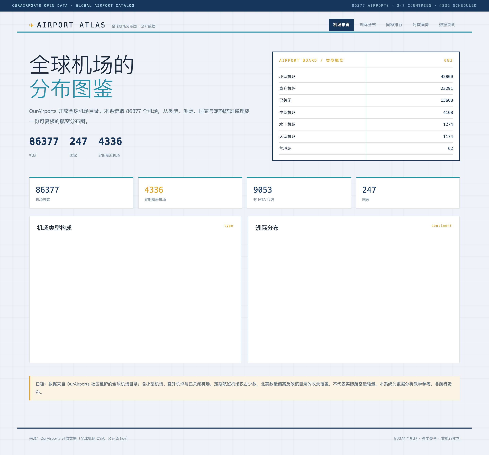
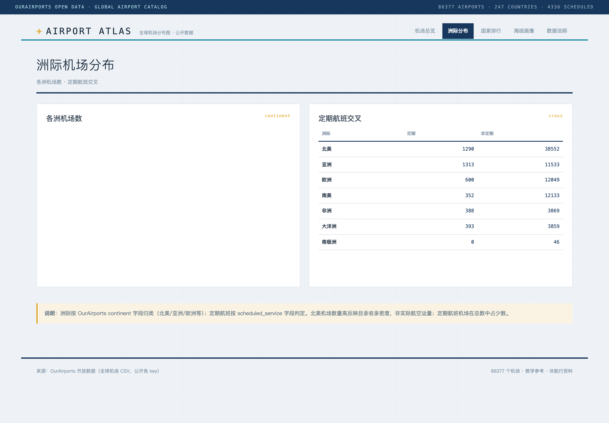
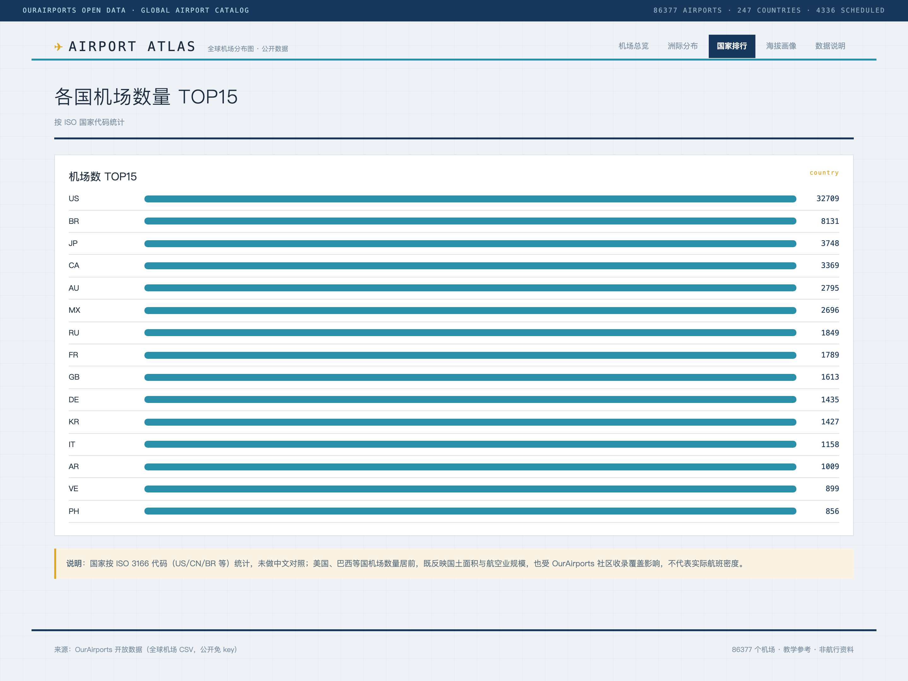
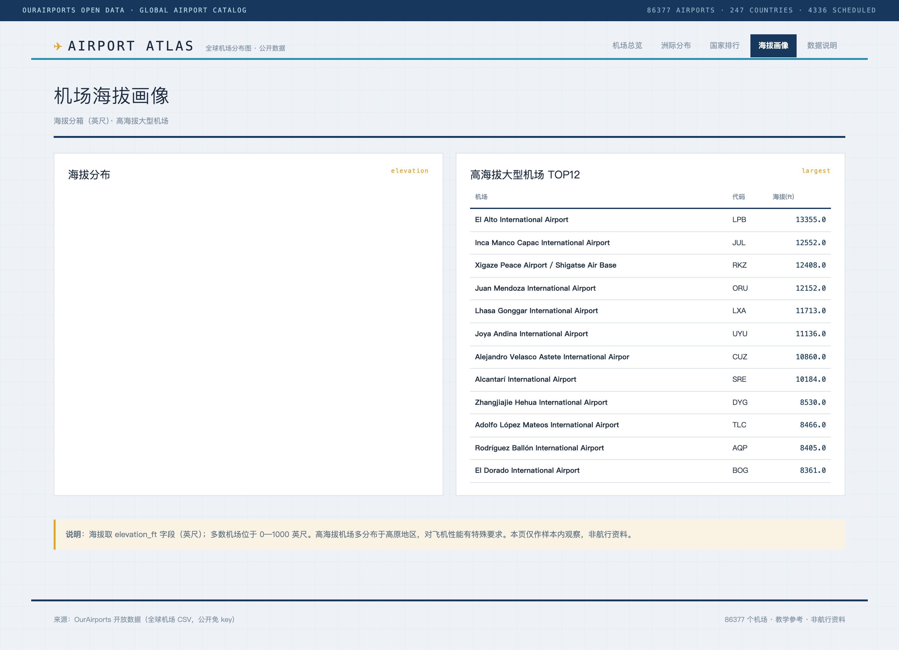
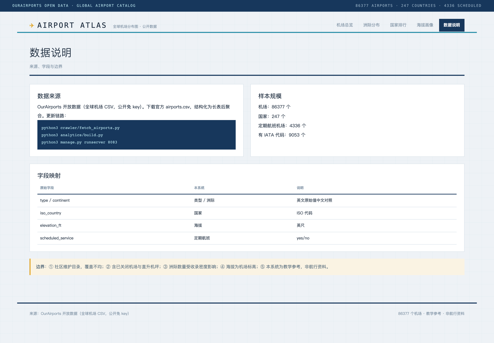

# 083 基于OurAirports公开数据的全球机场分布分析系统-设计展示

> **代码有偿获取 可接受定制 微信联系方式: csbysj2020 或 ACE2487，备注(BS)**

> **完整源码与全套文档 · 在线自助获取 >>> [https://mbd.pub/o/bread/YZaWmJtqZg==](https://mbd.pub/o/bread/YZaWmJtqZg==)**

> **成品页（功能介绍 / 更多选题）>>> [https://bishe.suilang.net/products/airport-atlas](https://bishe.suilang.net/products/airport-atlas)**

> 

> 

## 视频

> **点击查看 >>> [https://www.bilibili.com/video/BV1EbyazUEbX/](https://www.bilibili.com/video/BV1EbyazUEbX/)**

## 项目简介

航空导航图风格（夜空蓝、航图青、琥珀航标、经纬网格），区别于古籍书页/博物图鉴/藏书阁。采集 OurAirports 公开机场目录 86377 个（247 国家、4336 定期航班机场），从类型、洲际、国家与海拔四维分析。Django + Chart.js（本地化离线可用），5 个页面。社区目录覆盖偏差与定期航班口径如实标注，非航行资料。

机场是观察全球航空基础设施分布的数据窗口。

本项目设计并实现了一套基于 OurAirports 公开数据的机场分布分析系统：下载官方机场目录 CSV，清洗后得到 86377 个机场记录，从类型构成、洲际分布、国家格局与海拔规律四个维度聚合分析。

系统采用 Django + Chart.js 与航空导航图式界面（夜空蓝、航图青、琥珀航标、经纬网格），实现机场总览、洲际分布、国家排行、海拔画像、数据说明 5 个页面。

本仓库为**设计展示**：包含项目说明、技术架构、实验结果与运行截图；完整源码、任务书、开题报告、毕业论文与使用说明可通过上方链接自助获取，成品页可查看更多选题，也可联系微信咨询定制。

## 功能特性

1. 差异化视觉：航空导航图（夜空蓝/航图青/琥珀航标），非看板/画廊/博物图鉴

2. 真实采集：OurAirports 官方 CSV 公开免 key，86377 个机场

3. 类型画像：小型机场/直升机坪/大型机场等 7 类

4. 洲际分布：各洲机场数与定期航班交叉

5. 国家排行：TOP15 国家机场数

6. 海拔画像：海拔分箱与高海拔大型机场

7. 技术栈差异化：Django + Chart.js（本地化）

8. 合规边界：社区目录覆盖不均、含已关闭机场、非航行资料

## 技术架构

| 项目 | 说明 |
| --- | --- |
| 编程语言 | Python 3.8+ |
| Web 框架 | Django 4.2 |
| 图表 | Chart.js（本地化离线可用） |
| 数据源 | OurAirports CSV（公开免 key） |
| 样本规模 | 86377 机场 / 247 国家 |
| 运行端口 | http://127.0.0.1:8083 |
| 说明 | 数据直读 analysis JSON，无需数据库 |

## 目录结构

以下为完整交付版的结构（本仓库仅作设计展示）：

```
airport-atlas/
├── airportapp/
│   ├── __init__.py
│   └── app.py
├── airportproj/
│   ├── __init__.py
│   ├── settings.py
│   ├── urls.py
│   └── wsgi.py
├── analytics/
│   └── build.py
├── crawler/
│   └── fetch_airports.py
├── data/
│   ├── analysis/
│   │   ├── continents.json
│   │   ├── countries.json
│   │   ├── cross.json
│   │   ├── elevation.json
│   │   ├── largest.json
│   │   ├── scheduled.json
│   │   └── types.json
│   ├── processed/
│   │   └── airports.csv
│   └── stats.json
├── static/
│   ├── css/
│   │   └── style.css
│   └── vendor/
│       └── chart.umd.min.js
├── templates/
│   ├── about.html
│   ├── base.html
│   ├── countries.html
│   ├── elevation.html
│   ├── overview.html
│   └── regions.html
├── 任务书/
│   └── 毕业设计任务书.docx
├── 开题报告/
│   └── 毕业设计开题报告.docx
├── 最终论文/
│   ├── 图/
│   └── …
└── …
```

## 数据与实验结论

- 实验显示样本覆盖 247 个国家，小型机场与直升机坪占多数，定期航班机场仅 4336 个。
- 真实采集：OurAirports 官方 CSV 公开免 key，86377 个机场
- 类型画像：小型机场/直升机坪/大型机场等 7 类
- 国家排行：TOP15 国家机场数

## 交付内容

1. 完整源码（Django 应用 + 采集器 + 分析引擎 + 5 页面）
2. 真实数据（airports.csv + analysis JSON）
3. 任务书与开题报告（Word）
4. 毕业论文（Word 七章制）
5. 二次开发说明（Word+md）
6. 5 张截图 + 封面 + 演示视频

## 常见问题

**为什么北美机场特别多？**

反映 OurAirports 社区目录收录密度，不代表实际航空运量。

**包含已关闭机场吗？**

包含，type=closed 单独归类统计。

**定期航班怎么判定？**

按 scheduled_service 字段 yes/no。

**图表能离线用吗？**

能，chart.umd.min.js 已本地化到 static/vendor/。

## 截图






